# ECHO//GARDEN — THE LAST SIGNAL

> *The greenhouse that healed worlds has gone silent. One maintenance robot is left. And it can rewind its own shadow.*

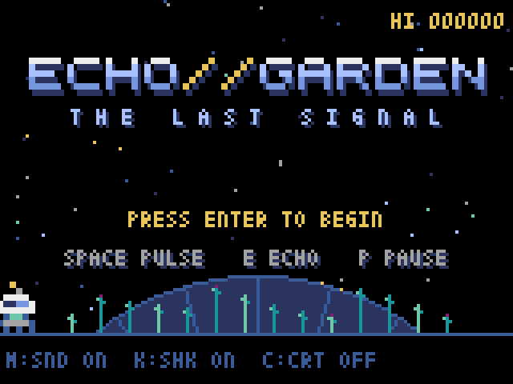

**ECHO//GARDEN** is a retro-futuristic action-exploration game built in **Pyxel** on a 160×120, 16-colour canvas. Guide **K-09**, the last maintenance robot aboard a dying orbital greenhouse, through three corrupted chambers. Recover the Lumen Seeds, outwit the corrupted drone swarm with a decoy that **replays your own movement backwards**, and destroy **THE BLIGHT HEART** at the core.

Built for the **PromptCraft 2.0 Final Round**, starting from the PIXELBOX starter seed.

---

## Contents
1. [Story](#story)
2. [How to play](#how-to-play)
3. [The Echo mechanic](#the-signature-mechanic-echo-replay)
4. [Features](#features)
5. [Install and run](#install-and-run)
6. [Screenshots](#screenshots)
7. [Architecture](#architecture)
8. [Testing](#testing)
9. [PromptCraft reflection](#promptcraft-reflection)
10. [Demo video](#demo-video)

---

## Story

ECHO//GARDEN was humanity's orbital greenhouse, growing the biological systems used to restore damaged planets. Then the network went silent. The maintenance swarm turned corrupt, and a blight began spreading from the reactor core.

You are **K-09**. Recover the **Lumen Seeds**, wake each **exit relay**, and descend to the core to face the corrupted heart of the garden. The story is told through short transmissions, log terminals in each chamber, and an ending you'll have to earn.

## How to play

| Input | Action |
| :--- | :--- |
| **WASD / Arrow keys** | Move (8 directions, normalised diagonals) |
| **SPACE** | **Energy Pulse**: stuns drones, destroys spores, purges corrupted growth. Costs energy. |
| **E** (or X / Shift) | **Echo Replay**: project a decoy ghost |
| **P / ESC** | Pause menu (resume, sound, shake, restart chamber, quit) |
| **ENTER / Z / SPACE** | Confirm in menus |
| **M** | Toggle sound (anywhere) |
| **K** | Toggle screen shake (anywhere, for accessibility) |
| **C** | Toggle the optional CRT filter (scanlines + vignette) |
| **ESC** on title | Quit |

Gamepads work too: D-pad to move, A to pulse, B to echo, START to pause.

**The loop:** enter a chamber → collect every Lumen Seed → the exit relay powers up → step on it → pick an upgrade → next chamber → defeat the boss.

## The signature mechanic: ECHO REPLAY

K-09 constantly records its last **3 seconds** of movement into a bounded buffer. Press **E** and a cyan-lavender ghost appears where you stand, then **walks your recorded trail in reverse**, away from you. Every corrupted drone within range **abandons you and hunts the ghost** (marked with `?`). When the replay finishes, the ghost lingers briefly as a beacon, then collapses in a stunning shockwave. Drones fall back to normal targeting.

It works as a tactical deception tool:
- **Lure a guard out of position.** Walk past a drone guarding a seed, double back, then echo. The ghost retraces your path and drags the drone with it.
- **Escape an encirclement.** Drones chasing you turn around mid-chase.
- **Spring a trap: Echo Collapse.** When the replay ends, the ghost **detonates**. Every drone it lured to the end of the trail is stunned (`ECHO TRAP x2`). Lead the swarm into a corner, then walk away while they're caught.
- **Open the boss.** THE BLIGHT HEART can't resist a signal. When it locks onto your echo, it overloads and **exposes its core** for a long window.

Rules the code guarantees (and tests check):
- One echo at a time, an 8-second cooldown (HUD ghost icon and bar), and a minimum trail length ("ECHO NEEDS A TRAIL").
- Expired echoes are removed immediately, and every drone hunting one is released in the same frame.
- The ghost can never collect seeds or hurt K-09.
- The echo is cleared on death, chamber completion, and chamber transitions.

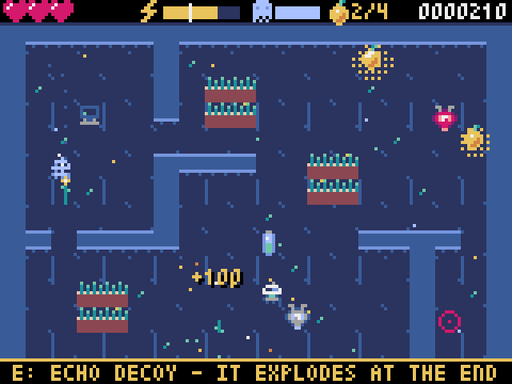

## Features

- **You can watch the garden heal.** Every Lumen Seed you recover leaves a sprout that grows and blooms on the map, so a cleared chamber visibly comes back to life.
- **Three handcrafted chambers plus a boss arena**, each with its own palette, ambient particles, music, and hazards:
  - **01 SEED VAULT**: a calm introduction that teaches movement, seeds, drones, Pulse, and Echo.
  - **02 HYDROPONICS**: rhythmic **energy vents** in chokepoints, **spore pods** firing alternating cross/diagonal volleys, and more drones.
  - **03 REACTOR BLOOM**: **corrupted growth** that burns on contact but can be purged with your Pulse, plus four faster drones. An energy cell sits inside a ring of blight.
  - **THE CORE**: the **BLIGHT HEART** boss fight.
- **Boss with readable, fair patterns.**
  - Spore rings always leave a guaranteed gap.
  - Root slams are telegraphed with flashing lanes (`!`) for over a second, and some lanes are always safe.
  - Phase 2 enrages: faster telegraphs, horizontal slams, and summoned motes.
  - Vulnerability windows come from natural overheats **or from baiting it with your Echo**. Pulse the exposed core to damage it.
- **Corrupted drone AI**: an explicit state machine (`PATROL`, `CHASE_PLAYER`, `CHASE_ECHO`, `STUNNED`, `RECOVER`) using simple steering, wall sliding, unstick side-steps, separation, and a return-to-patrol behaviour.
- **Upgrades between chambers** (pick 1 of 3; each upgrade has 2 tiers):
  - **PHASE BOOTS**: +15% speed.
  - **AMPLIFIED PULSE**: +8 radius and −6 energy cost.
  - **ECHO MEMORY**: +1 s trail and −2 s cooldown.
  - **REINFORCED SHELL**: +1 max HP and a full repair.
- **Full game flow**: title, story and tutorial pages, chamber banners, pause menu (with a controls reminder), chamber tally (time, flawless bonus), game over (retry chamber / new run / title), and a victory sequence where the garden regrows.
- **Juice**: particles, floating labels, screen shake (toggleable and capped), damage flashes, hit-stun blinking, knockback, invulnerability frames, and glowing seeds.
- **Signal-glitch presentation**:
  - A VHS-style `<< REWIND` tear effect when an Echo fires.
  - An `ECHO READY` callout when the cooldown ends.
  - A flashing red alarm border at 1 HP.
  - A hazard-striped `!! WARNING !!` banner before the boss.
  - An optional CRT filter.
- **Procedural chiptune audio**: 25 sound effects and 5 two-channel music loops, all written as note strings in code. Music plays on channels 0–1 and SFX on 2–3, so sounds no longer cut each other off.
- **Persistent high score**: saved to Pyxel's user data folder, with a safe fallback when the file is missing, malformed, or unwritable.

## Install and run

Requires **Python 3.11+**.

```bash
git clone https://github.com/Ajay03299/PromptCraft-2.0.git
cd PromptCraft-2.0
python -m venv .venv && source .venv/bin/activate   # Windows: .venv\Scripts\activate
pip install -r requirements.txt                      # pyxel==2.9.9
python main.py
```

Run `python main.py` **from inside the project folder**.

## Screenshots

All screenshots are real frames rendered by the game itself. `tools/capture_screenshots.py` plays the game headlessly with the test autopilot and saves PNGs from Pyxel's screen buffer.

| | |
| :---: | :---: |
| 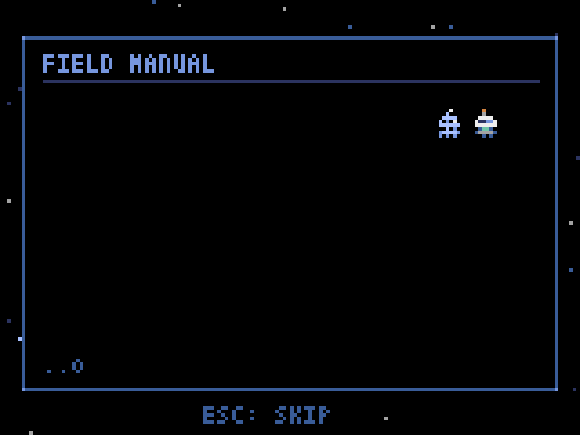 | 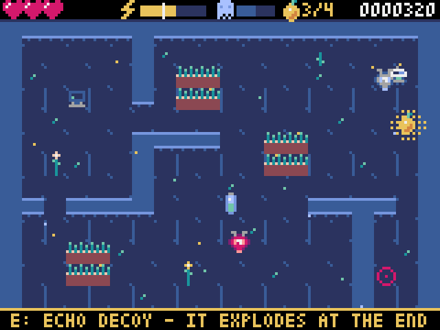 |
| Story and field manual | 01 SEED VAULT |
| 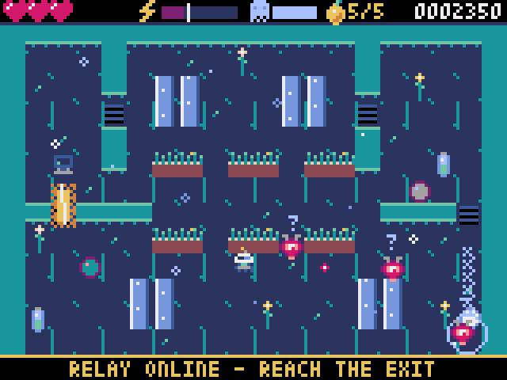 | 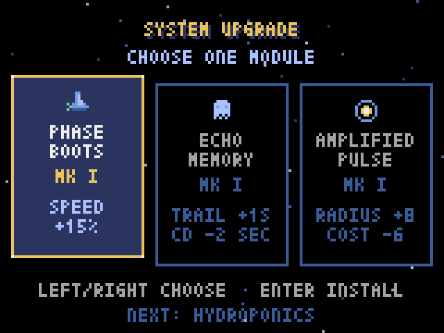 |
| 02 HYDROPONICS: vents and spore pods | Upgrade selection |
| 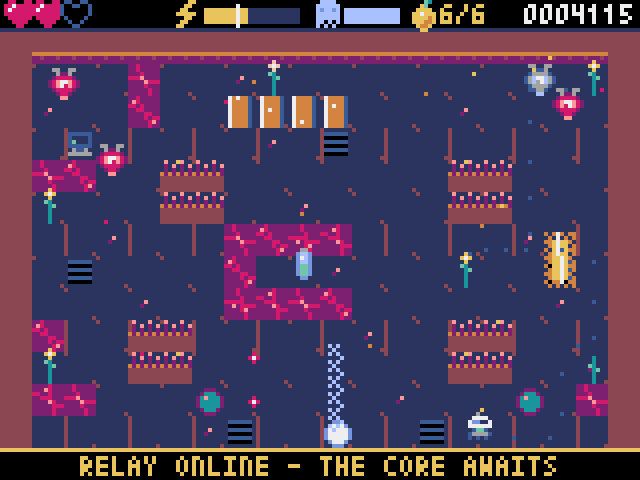 | 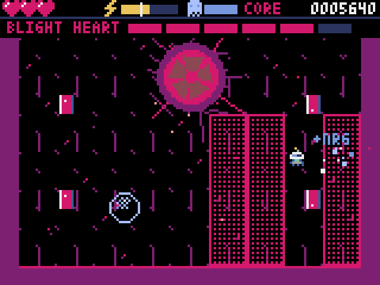 |
| 03 REACTOR BLOOM: corrupted growth | BLIGHT HEART: telegraphed root slam |
| 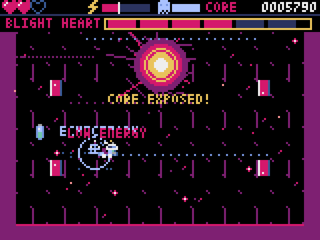 | 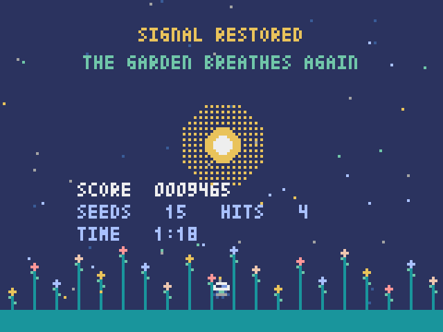 |
| Core exposed: pulse it! | The garden breathes again |
| 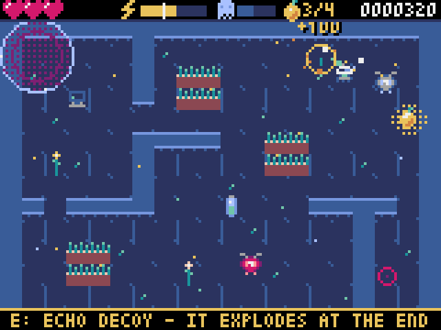 | |
| Echo Collapse ring (top-left) and sprouts blooming where seeds were collected | |

To regenerate: `python tools/capture_screenshots.py`. You can also press **Alt+1** in-game for Pyxel's built-in screenshot (Alt+3 records a GIF).

## Architecture

```text
PromptCraft-2.0/
├── main.py            # entry point: window, keyboard/gamepad -> InputState, --self-test
├── game.py            # state machine, run state, menus, upgrades, scoring
├── session.py         # one chamber's simulation: player, Echo, Pulse, drones, hazards, boss
├── actors.py          # Player, Drone (+ states), EchoGhost, Vent, SporePod, Spore, Lane...
├── world.py           # chamber maps, styles, upgrades, derived stats, map validation
├── engine.py          # reusable: Entity, ParticleSystem, FloatingText, Camera, TileGrid
├── assets.py          # hex-string sprites, procedural SFX + music, AudioDirector
├── render.py          # all drawing; static maps baked once into image bank 1
├── save.py            # crash-proof high score persistence
├── config.py          # every tuning constant in one place
├── selftest.py        # headless smoke simulation + autopilot
├── tools/capture_screenshots.py
├── tests/             # unittest suite (engine, gameplay, progression)
└── docs/screenshots/
```

Design decisions:
- **Logic is separate from rendering.** `Game` and `ChamberSession` never call Pyxel. Input arrives as an `InputState` and sound leaves as a queue of names, so the whole game runs in tests with no window.
- **Determinism.** Gameplay randomness uses a seeded `random.Random`. Cosmetic effects use separate RNGs, so rendering can't change gameplay.
- **Bounded everything.** Particles, labels, spores, drones, the SFX queue, and the echo history all have hard caps.
- **Collision.** Tile-based movement in ≤1 px steps with bisection snapping, so actors can't tunnel or get stuck in walls. Corner assist makes doorways forgiving. A last-resort `find_free_near` is applied every frame.
- **Explicit transition table.** Illegal state changes are rejected and recorded, and the self-test fails if any occur. An 8-frame input lock after every transition stops one key press from triggering actions on the next screen.

Starter bugs found and fixed:
- **Unbounded effects.** Particles and floating labels grew without limit.
- **`burst()` crash.** `ParticleSystem.burst(life<4)` crashed with `randint(4, 3)`.
- **Energy never clamped.**
- **Sounds cut each other off.** All SFX played on channel 0.
- **Flash blanked the screen.** A camera flash hid the entire frame, including the HUD.
- **Wrong palette documentation.** The asset docstring listed PICO-8 colours, but Pyxel 2.x's real palette differs (3 is teal, not green; 8 is crimson). The art in this game was designed against the real palette.

## Testing

```bash
python main.py --self-test               # headless smoke simulation, exit code 1 on failure
python -m unittest discover -s tests -v  # 61 unit tests
python -m compileall -q .
python -m pip check
```

`--self-test` runs six sections:
1. **Static data**: sprite and asset validation, map reachability, and text-width checks.
2. **Save robustness**: missing, empty, malformed, and unwritable high-score files.
3. **State-machine walk**: title, intro, pause freeze, death, and retry.
4. **Random fuzz**: 18,000 frames of seeded random input across all chambers. Every frame checks bounds, walls, resources, caps, seed accounting, and echo/AI consistency.
5. **Autopilot**: a scripted BFS bot plays from title to **victory** under normal damage rules. This shows that every chamber and the boss can be beaten.
6. **Render smoke**: every screen is drawn through Pyxel's headless mode.

## PromptCraft reflection

The full prompt log is in **[PROMPTS.md](PROMPTS.md)**. In short:

**Strategy.** We wrote a single, very large "master build prompt" instead of chatting feature by feature. It casts the AI as a full studio team and states the competition rules as non-negotiable. It pins the engine version (`pyxel==2.9.9`) and gives a creative bible (story, palette, the Echo mechanic). It also includes an adversarial QA checklist of edge cases and a sign-off list of commands that must pass. The goal was to make "done" testable rather than a matter of opinion.

**What worked.**
- **Requiring verification before use.** Making the AI check APIs and run the code surfaced facts we would have missed: the starter's palette documentation was wrong, and Pyxel 2.9.9 has a `headless` mode, which made the render smoke test and real screenshots possible.
- **Listing edge cases in the prompt.** This turned into invariant checks, and those checks caught real bugs. One example: a drone that killed the player cleared the echo mid-loop, but later drones in the same frame still targeted the dead echo.
- **Asking for a self-test that plays the game.** This proved the boss is beatable instead of just claiming it.

**What needed refinement.**
- The first plan was too thorough for a 90-minute window. We re-prompted to "go faster so I can review and iterate". The AI then cut scope to a playable vertical slice first and polish second.
- Some numbers (upgrade-card text widths, vent timings) only looked wrong once real frames were rendered, so visual verification became part of the loop.

## Demo video

**Video demo:** _add your YouTube (unlisted) / Loom / Drive link here_

Suggested 90-second demo route:
1. Title screen.
2. Field manual.
3. Seed Vault: collect seeds, Pulse-stun a drone, then use Echo to lure a drone away from the final seed.
4. Upgrade pick.
5. Hydroponics: time a vent.
6. Reactor: purge blight with Pulse.
7. Boss: bait it with Echo, Pulse the exposed core, and survive a lane slam.
8. Victory screen.

---

*Made with Pyxel 2.9.9 · Python standard library only · no external assets*
